# Microsoft Entra ID — Identity & Access Management Lab

**Hands-on IAM portfolio project | Microsoft Entra ID Free | SAML SSO | MFA | User Lifecycle Management**

## Overview

I built a small, fictional company environment in Microsoft Entra ID to practice identity lifecycle and access management tasks commonly performed by IAM analysts. Acting as the organization's administrator, I onboarded test employees, managed a security group, configured a SAML enterprise application, registered an MFA method, reviewed authentication and audit records, and carried out a simulated employee offboarding.

**Organization:** Northstar Technologies (fictional)  
**Test identities:** Michael Kaps (Finance) and Daniel Brooks (IT) — both fictional  
**Platform:** Microsoft Entra ID Free  
**Test application:** Microsoft Entra SAML Toolkit

> **Scope:** This is a cloud-based Microsoft Entra ID lab, **not** an on-premises Active Directory or hybrid AD synchronization deployment. All users and access changes described here were made in a test tenant.

## Skills practiced

- **Identity lifecycle:** Create and maintain cloud employee accounts and organizational attributes
- **Access management:** Create an assigned-membership security group and manage group membership
- **Enterprise applications:** Assign a test user to an application and remove that assignment
- **SAML SSO:** Configure entity ID, reply (ACS) URL, sign-on URL, signing certificate and NameID mapping
- **Authentication security:** Register Microsoft Authenticator and complete its number-matching setup verification; inspect tenant Security Defaults
- **Monitoring and troubleshooting:** Review Entra sign-in events, interrupted authentication, and audit records
- **Offboarding:** Remove application access and group membership, disable an employee identity, and revoke sign-in sessions

## Lab environment

| Component | Purpose |
| --- | --- |
| Microsoft Entra ID Free | Cloud identity provider and administrative directory |
| Microsoft Entra SAML Toolkit | Sample SAML service provider for integration testing |
| Microsoft Authenticator | Registered authentication method for the test user |
| Microsoft Entra sign-in and audit logs | Authentication and change tracking |
| Web browser | Administration and testing (no local Windows Server VM required) |

## Architecture

```text
Fictional employees
  ├─ Michael Kaps — Finance
  └─ Daniel Brooks — IT
          │
          ▼
Microsoft Entra ID (identity provider)
  ├─ Cloud user accounts and attributes
  ├─ Finance Employees security group
  ├─ Enterprise application assignment
  ├─ SAML settings and signing certificate
  └─ Microsoft Authenticator registration
          │
          ▼
Microsoft Entra SAML Toolkit (test service provider)
```

> I used **individual user assignment** for the enterprise application. I did not configure paid-tier group-based application assignment, Conditional Access policies, or an on-premises Active Directory server.

## Implementation and evidence

### 1. Provision test employees

I created two internal users with fictional job titles, departments and employee IDs, representing new hires in Finance and IT.

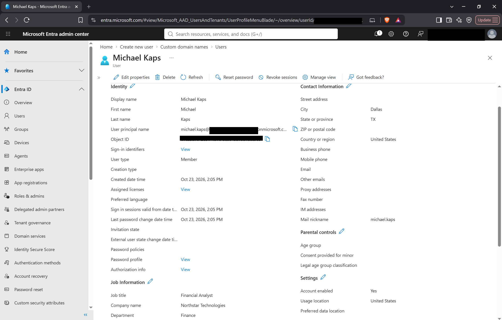
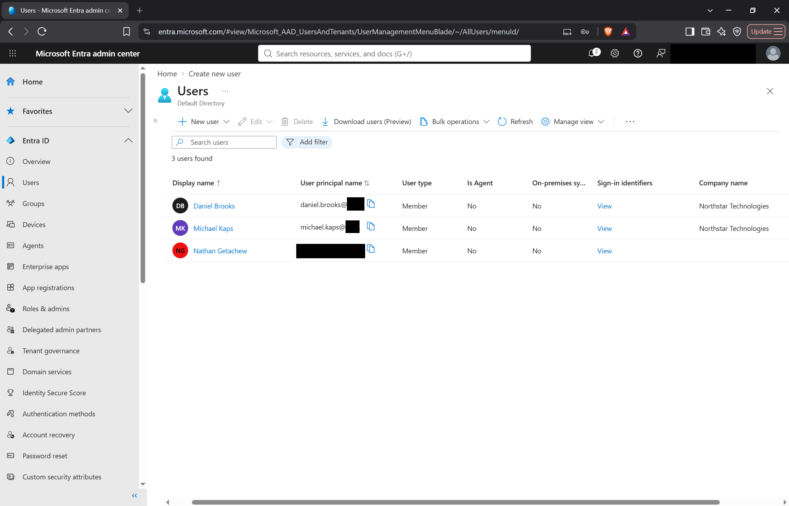

### 2. Create and manage a security group

I created an assigned-membership **Finance Employees** security group and added Michael, while leaving Daniel outside the Finance group. The group did not automatically grant access to the SAML Toolkit.

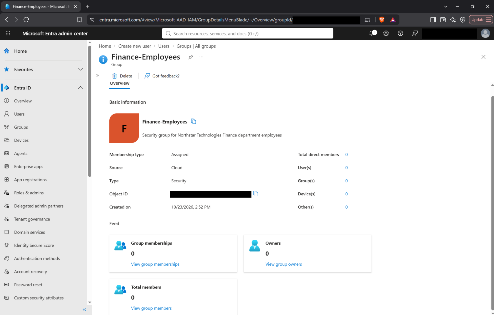
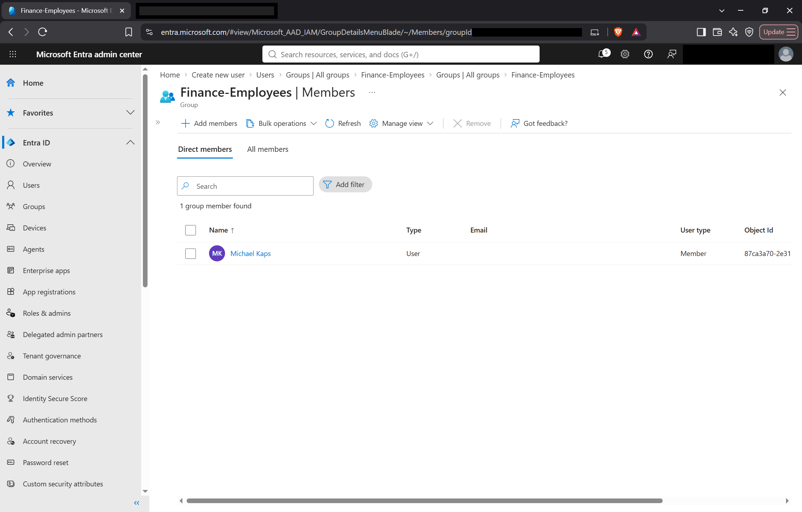

### 3. Assign and configure an enterprise application

I added **Microsoft Entra SAML Toolkit** to Enterprise Applications and assigned Michael individually. I configured the SAML service provider's Entity ID, connection-specific Assertion Consumer Service (ACS) URL and sign-on URL. On the application side, I supplied the Entra Login URL, Identifier and public signing certificate, and verified the NameID configuration used an email-address format with the user principal name.

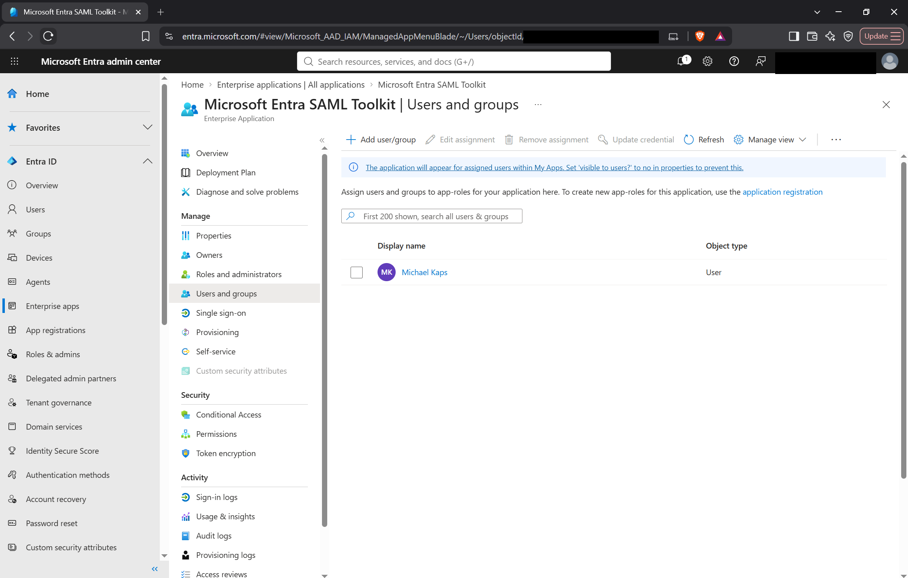

### 4. Troubleshoot and validate SAML authentication

During testing, the Toolkit returned an application processing error. I checked the SAML configuration on both sides, the signing certificate, and the NameID claim. I also distinguished the Toolkit's separate password login from the Microsoft Entra SSO flow, and retested using the assigned employee rather than the administrator account.

Entra subsequently recorded a **successful sign-in for Michael to the Microsoft Entra SAML Toolkit**. An earlier **interrupted** My Apps event was also visible in the log. I documented the failure and the later successful Entra authentication rather than concealing unsuccessful attempts.

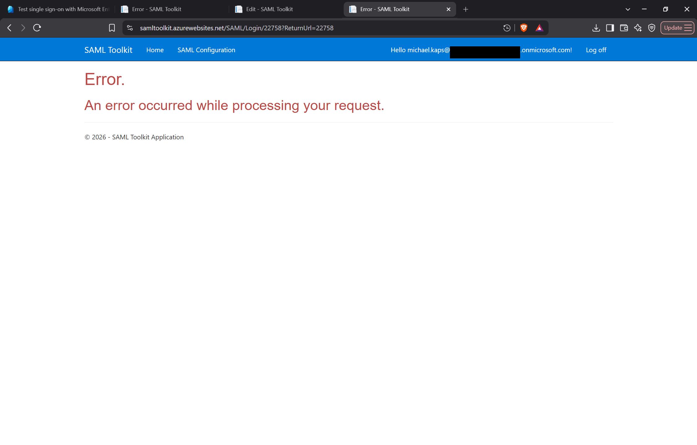
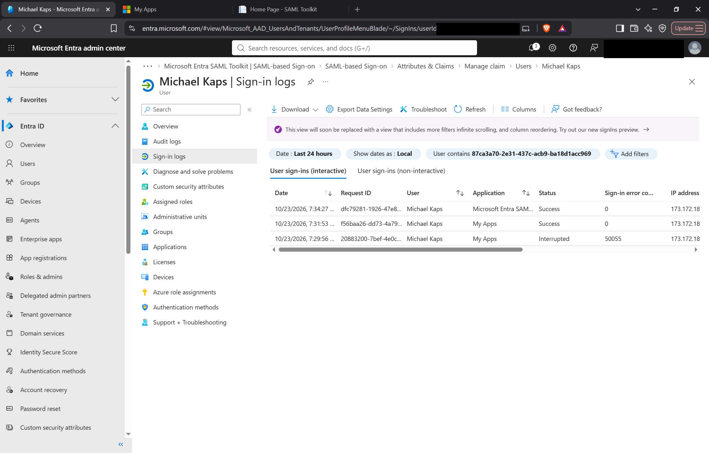

**Evidence limitation:** A successful Entra sign-in event confirms identity-provider authentication for the application. Because an existing Toolkit session was present during part of testing, the screenshots alone do not conclusively demonstrate a completely fresh, session-free end-to-end SAML login to the Toolkit. I have not represented that stronger claim as verified.

### 5. Register and verify an MFA method

I checked tenant **Security Defaults**, inspected Michael's authentication methods before registration, registered Microsoft Authenticator, and completed the setup's number-matching notification approval. I then confirmed that Authenticator appeared in the user's Security Info page.

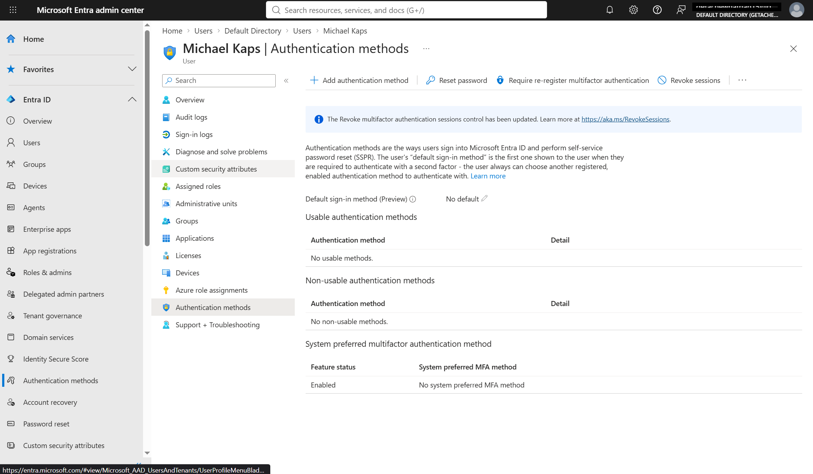
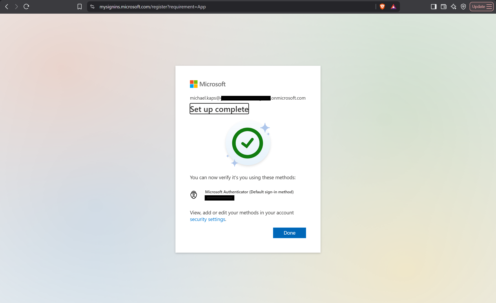
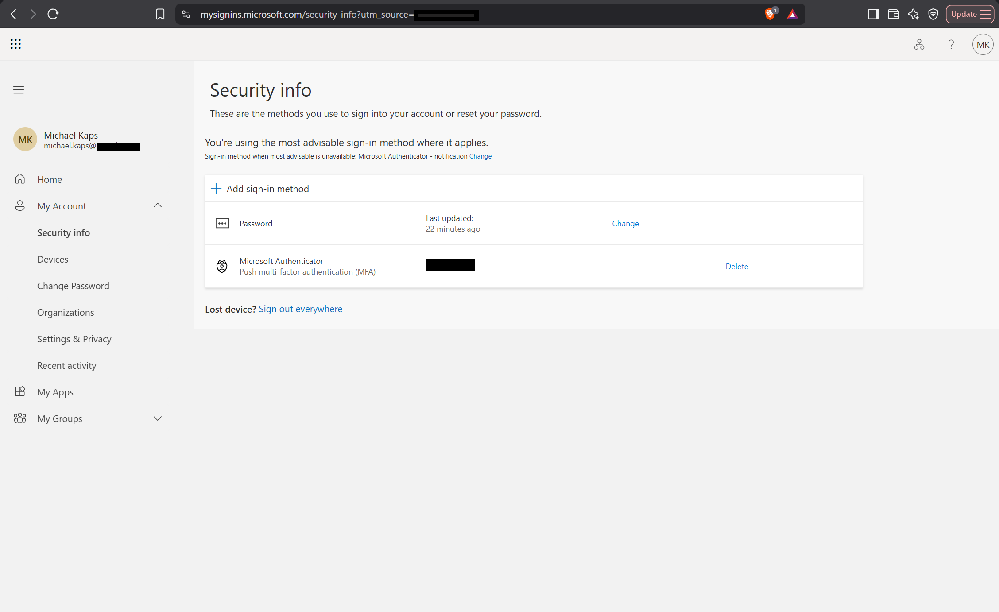

**Evidence limitation:** These steps demonstrate **MFA method registration and setup verification**. They do not, by themselves, establish that a specific subsequent SAML application sign-in was challenged for MFA.

### 6. Simulate employee offboarding

For the fictional departure of Michael Kaps, I:

1. Removed his assignment to the test enterprise application.
2. Verified the successful removal in Microsoft Entra audit logs, including the affected user and application.
3. Disabled his Entra user account.
4. Removed his Finance group membership.
5. Revoked his Entra sign-in sessions.

The final user overview showed a **disabled** account with **zero group memberships** and **zero application assignments**. Revoking sessions reduces ongoing Entra sign-in access; it does not guarantee that all existing third-party application sessions immediately terminate.

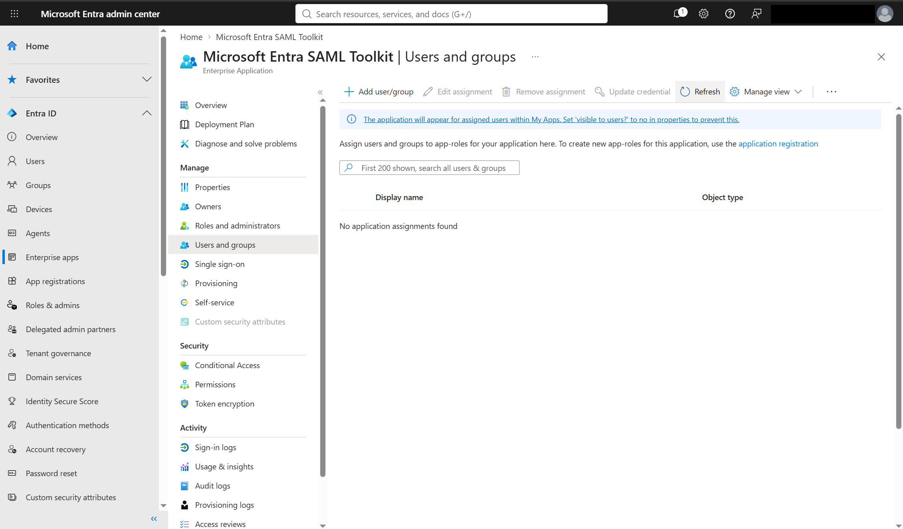
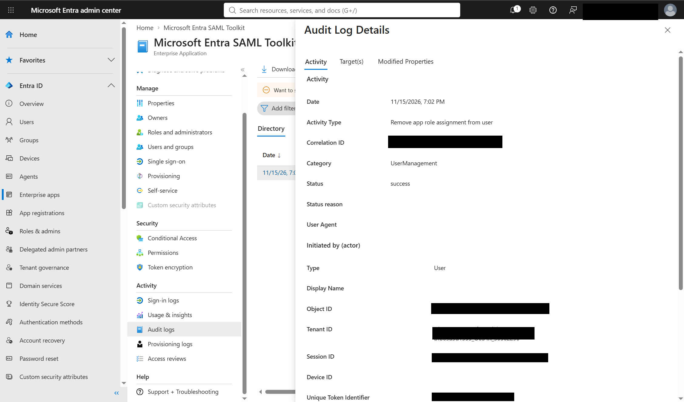
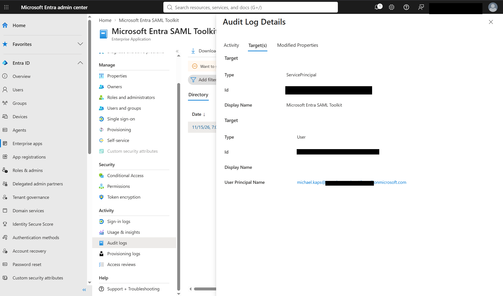
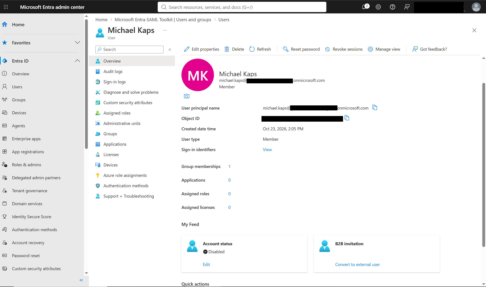
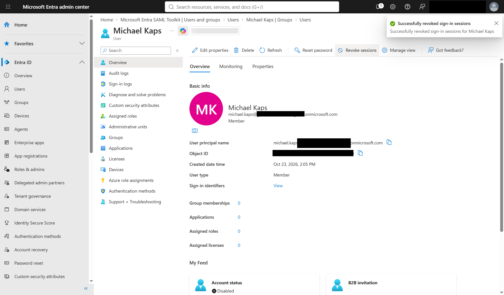

## Key takeaways

- Creating an identity, assigning an application, and configuring SSO are distinct administrative tasks.
- A security group documents membership but does not automatically grant application access; entitlement assignment must be configured separately.
- Troubleshooting SAML requires checking both identity-provider settings and service-provider settings, as well as knowing which user and session initiated a test.
- Authentication logs and audit logs provide different evidence: **sign-ins** versus **configuration and access changes**.
- Offboarding includes removing entitlements, disabling the account, and addressing active sessions; account deletion is not required to demonstrate the workflow.

## Security and privacy

All named employees and the company are fictional. Screenshots for this public portfolio are redacted to avoid exposing personal email addresses, tenant and object IDs, IP addresses, device identifiers, session details, QR codes, passwords and authentication data. The downloaded SAML signing certificate and any credentials are **not included** in this repository.

## Future extensions

- Build a separate Active Directory Domain Services lab and, if feasible, a hybrid identity synchronization exercise.
- Add scripted user and group reporting through Microsoft Graph PowerShell.
- Perform a clean-session, end-to-end SAML sign-in test and capture both the authentication flow and application-side success.
- Compare Microsoft Entra ID workflows with Okta identity administration.

---

*Independent educational lab; not production IAM employment or an official Microsoft certification.*
